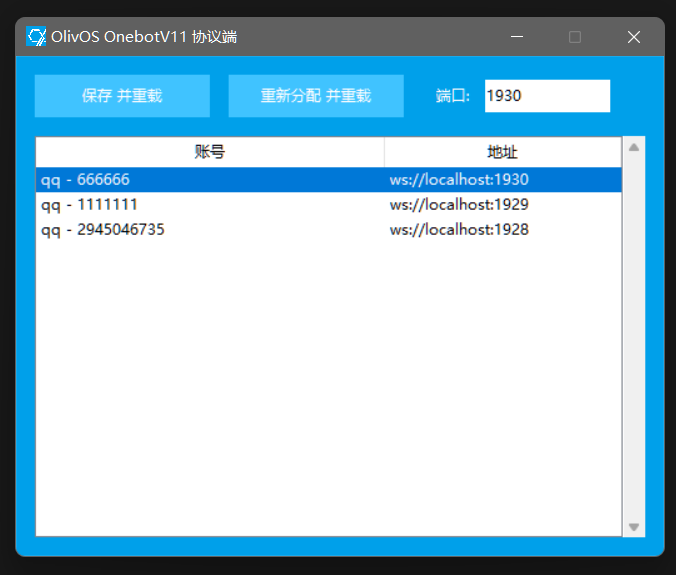

# OlivOSOnebotV11
Onebot V11 for OlivOS

基于[OlivOS](https://github.com/OlivOS-Team/OlivOS)的[OneBot](https://onebot.dev/)协议端，可以基于OlivOS实现**多后端**对**多账号**、**多平台**的支持。

### 鸣谢
本项目基于以下项目进行开发
- [OlivOS-Team/OlivOS](https://github.com/OlivOS-Team/OlivOS)
- [python-websockets/websockets](https://github.com/python-websockets/websockets)
- [OneBot](https://onebot.dev/)

### 项目特点
+ 采用了无扩展的实现方式，采用分端口的方式完美的实现了对于多账号的支持，可以无修改的支持现存的`OnebotV11`协议应用后端。  
+ 采用了ID映射机制，可以使CQ时代的后端完全无修改的适配诸如`QQ开放平台`这类ID并非纯数字的平台。  
+ 采用了群组映射机制，可以使CQ时代的后端完全无修改的适配诸如`KOOK`、`Discord`这类存在多层群组的平台。  
+ 多账号，丰富的映射机制，以及完整的交叉支持，基于先进的`OlivOS`对于大量平台的适配使得本项目可以完美的支持多账号，多后端，多平台的组合。  

### 开始使用
在不进行任何设置的前提下即可使用本插件，你可以通过插件菜单打开设置面板查看并修改端口，未设置时将在第一次启动时为每个账号生成一个可用端口。  



### 进阶使用
在`OlivOS`的`0.9.7`版本后的启动流程中你将能直接在日志中看到如下内容，其表明了每个已被加载的账号被分配到的的`hash`

```powershell
[2022-03-23 23:06:50] - [INFO] - init account from [./conf/account.json] ... done
[2022-03-23 23:06:50] - [INFO] - generate [qq] account [123456789] as [3cfede0d58a99a0fe71846310e9cac47] ... done
[2022-03-23 23:06:50] - [INFO] - generate [telegram] account [456789123] as [48781dc6c1de335c504572b51420ea52] ... done
[2022-03-23 23:06:50] - [INFO] - generate [kaiheila] account [987654321] as [dea0b0e07ef3728456d4520eedc62fe7] ... done
[2022-03-23 23:06:50] - [INFO] - generate account ... all done
```

你需要创建或编辑`plugin/data/OlivOSOnebotV11/config.json`文件，其结构示例如下

```json
{
    "route": [
        {
            "hash": "3cfede0d58a99a0fe71846310e9cac47",
            "port": 44007
        },
        {
            "hash": "48781dc6c1de335c504572b51420ea52",
            "port": 44008
        },
        {
            "hash": "dea0b0e07ef3728456d4520eedc62fe7",
            "port": 44009
        }
    ],
    "r-route": [
        {
            "hash": "3cfede0d58a99a0fe71846310e9cac47",
            "path": []
        },
        {
            "hash": "48781dc6c1de335c504572b51420ea52",
            "path": [
                "ws://127.0.0.1:8080/onebot/v11/ws"
            ]
        },
        {
            "hash": "dea0b0e07ef3728456d4520eedc62fe7",
            "path": []
        }
    ],
    "http-route": [
        {
            "hash": "3cfede0d58a99a0fe71846310e9cac47",
            "port": 5700,
            "access_token": "token-a"
        },
        {
            "hash": "48781dc6c1de335c504572b51420ea52",
            "port": null
        }
    ],
    "r-http-route": [
        {
            "hash": "3cfede0d58a99a0fe71846310e9cac47",
            "path": [
                "http://127.0.0.1:8080/onebot/v11/http"
            ],
            "secret": "secret-a",
            "timeout": 5
        },
        {
            "hash": "48781dc6c1de335c504572b51420ea52",
            "path": []
        }
    ]
}
```

你还可以在`route`中设置正向WS服务，这表明了每个账号将会在分别对应的端口开启正向WS服务，如果设置成功，你将会看到如下日志内容

```powershell
[2022-03-23 23:06:54] - [INFO] - [OlivOSOnebotV11] - 账号 [qq|123456789] 运行于Websocket，请使用 [ws://127.0.0.1:44007] 进行连接
[2022-03-23 23:06:54] - [INFO] - [OlivOSOnebotV11] - 账号 [telegram|456789123] 运行于Websocket，请使用 [ws://127.0.0.1:44008] 进行连接
[2022-03-23 23:06:54] - [INFO] - [OlivOSOnebotV11] - 账号 [kaiheila|987654321] 运行于Websocket，请使用 [ws://127.0.0.1:44009] 进行连接
```

并且，当你的后端完成连接时，你将看到如下日志内容，这意味着你的整个配置过程已经彻底完成，并将开始正常运作

```powershell
[2022-03-23 23:07:12] - [INFO] - [OlivOSOnebotV11] - ('::ffff:X.X.X.X', YYYYY, 0, 0) - connected to [44008] for [telegram|456789123]
```

此外，你还可以在`r-route`中设置反向WS服务，`OlivOSOnebotV11`将会主动连接至你设置的地址，如果连接成功，你将会看到如下日志内容

```powershell
[2022-03-23 23:07:12] - [INFO] - [OlivOSOnebotV11] - ws://127.0.0.1:8080/onebot/v11/ws - connected for [48781dc6c1de335c504572b51420ea52]
```

### 正向HTTP

在`http-route`中为账号设置端口即可开启正向HTTP API。每个账号使用独立端口，`port`为`null`时表示关闭该账号的HTTP服务。正向HTTP与正向WS使用两套独立端口，可以同时开启。

也可以通过插件菜单中的“正向HTTP配置”窗口维护端口与`access_token`。

```json
{
    "http-route": [
        {
            "hash": "3cfede0d58a99a0fe71846310e9cac47",
            "port": 5700,
            "access_token": "token-a"
        }
    ]
}
```

OneBot V11 动作位于URL路径中，支持`GET`和`POST`。`GET`参数放在查询字符串中；`POST`支持`application/json`与`application/x-www-form-urlencoded`。例如：

```text
GET  http://127.0.0.1:5700/get_login_info
POST http://127.0.0.1:5700/send_private_msg
     {"user_id": 123456789, "message": "hello"}
```

配置`access_token`后，可以使用请求头或查询参数鉴权：

```text
Authorization: Bearer token-a
http://127.0.0.1:5700/get_login_info?access_token=token-a
```

HTTP状态码含义如下：成功执行动作为`200`；请求体不是合法JSON或表单为`400`；缺少令牌为`401`；令牌错误为`403`；动作不存在为`404`；`POST`的`Content-Type`不受支持为`406`；内部异常为`500`。失败响应仍返回OneBot风格的`status`、`retcode`和`data`字段。

### 反向HTTP

在`r-http-route`中为账号设置上报地址后，插件会以HTTP POST主动推送OneBot事件。一个账号可以配置多个地址；`secret`用于计算`X-Signature`，`timeout`为单次请求超时秒数。响应体可以是JSON对象，用于执行快速操作。

也可以通过“反向HTTP配置”窗口维护上报地址、`secret`与`timeout`。

```json
{
    "r-http-route": [
        {
            "hash": "3cfede0d58a99a0fe71846310e9cac47",
            "path": [
                "http://127.0.0.1:8080/onebot/v11/http"
            ],
            "secret": "secret-a",
            "timeout": 5
        }
    ]
}
```

上报请求使用`Content-Type: application/json; charset=utf-8`和`X-Self-ID`头部；配置`secret`时还会发送`X-Signature: sha1=<HMAC-SHA1>`。快速操作响应示例：

```json
{
    "reply": "收到",
    "auto_escape": false,
    "at_sender": true,
    "delete": false,
    "kick": false,
    "ban": false,
    "ban_duration": 60
}
```

其中`reply`支持CQ字符串或消息段数组，`auto_escape`表示将回复作为纯文本发送，`at_sender`表示在回复前@发送者；`delete`、`kick`、`ban`仅对消息事件有效，`ban_duration`单位为秒。正向WS、反向WS、正向HTTP和反向HTTP互不排斥，可以按账号同时启用。

### 安全提示

正向HTTP与正向WS默认监听`0.0.0.0`。如果将端口暴露到本机之外，请务必设置`access_token`；反向HTTP设置了`secret`时，接收端应校验`X-Signature`，避免伪造事件。正向HTTP配置页可维护端口与`access_token`，反向HTTP配置页可维护上报地址、`secret`与`timeout`，也可以直接编辑配置文件。

访问令牌和密钥留空表示不启用对应校验，反向HTTP的`timeout`留空时使用默认5秒。

### 需要注意

本插件虽然可以基于[OlivOS](https://github.com/OlivOS-Team/OlivOS)实现后端服务的跨平台，但是仍然需要后端服务本身给予足够的业务逻辑支持。
